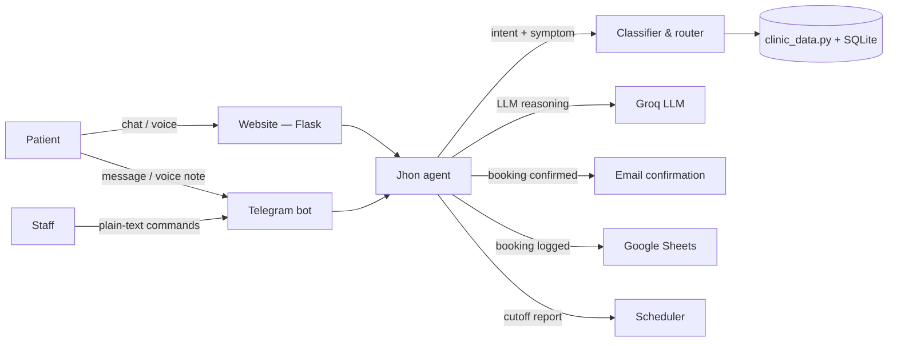

# JHON — AI Hospital Receptionist

> **An AI receptionist that answers patients, understands symptoms, suggests the right doctor, and books appointments — in Bangla and English, 24/7.**

[](https://www.python.org/)
[](https://flask.palletsprojects.com/)
[](https://groq.com/)
[](https://telegram.org/)
[](LICENSE)

A real hospital receptionist does more than answer the phone — they listen to the patient's problem, work out which department fits, check the doctor's schedule, book the slot, confirm it, and keep the records clean. **Jhon does all of that, automatically.**

Built with Python + Flask + Groq LLM + Telegram. One codebase, two front doors: a **website chat** for patients and a **Telegram bot** for patients *and* staff.

---

## 🎬 Demo

Watch Jhon book by symptom, by department, by name, by voice — then send the confirmation email, save to Google Sheets, and let staff manage doctors from Telegram:

📹 **[assets/jhon-demo-v3-2026-11-20-v33.mp4](assets/jhon-demo-v3-2026-11-20-v33.mp4)** (2 min, 1280×720)

---

## ⚡ Quick start

```bash
git clone https://github.com/<your-username>/jhon-ai-receptionist.git
cd jhon-ai-receptionist
pip install -r requirements.txt

cp .env.example .env        # fill in your own keys (see below)
python migrate_doctors.py   # one-time: loads the 19 doctors into the database

python web_server.py        # website  -> http://127.0.0.1:5000
python main.py              # Telegram bot (separate terminal)
```

That's it. Open the website, ask Jhon for a doctor — by symptom, department, or name — and get a booking with an email confirmation.

---

## ✨ Features

| Feature | What it does |
|---|---|
| 💬 **Website chat** | Bangla / English / Banglish text chat with a booking flow |
| 🎙️ **Voice booking** | Speak to Jhon from the browser (English / বাংলা) — phone needs HTTPS (`--https`) |
| 🩺 **Symptom → doctor** | Patient describes a symptom, Jhon suggests the right department and doctor |
| 📅 **Book by name / department** | "Book Dr. Ayesha Khan for Friday" or "I need a urologist" |
| ✉️ **Email confirmations** | Every booking sends a confirmation email via Gmail SMTP |
| 📊 **Google Sheets** | Every booking is logged to a sheet, one tab per doctor |
| ⏰ **Cutoff reports** | Before a chamber closes, staff get a report of the day's bookings; late bookings roll to the next day |
| 🧹 **Auto-clean data** | Future bookings are handled and old data is cleaned automatically |
| 🤖 **Telegram admin panel** | Staff add/remove doctors, move schedules, and pull reports — from plain-text Telegram messages |
| 🔄 **Auto-sync** | `clinic_data.py` and the SQLite database stay in sync; data changes need no restart |

**Real data, no demos faked:** 19 doctors across 12 departments (Cardiology, Dentistry, Dermatology, ENT, Gastroenterology, General Medicine, Gynecology, Neurology, Ophthalmology, Orthopedics, Pediatrics, Urology), with real weekly schedules.

---

## 🧠 How it works



1. **Patient talks** — website chat, voice, or Telegram. Bangla, English, or Banglish.
2. **Jhon understands** — intent classifier + symptom router pick the department and doctor; the Groq LLM handles the conversation.
3. **Jhon books** — checks the real schedule, confirms the day and time with the patient, then saves the booking to SQLite.
4. **Jhon confirms** — sends a confirmation email and logs the booking to Google Sheets.
5. **Staff stay in control** — Telegram commands add/remove doctors and pull reports; the scheduler sends cutoff reports before each chamber closes.

The LLM never invents doctors, departments, or schedules — every answer comes from the real clinic data. (Primary model `llama-3.3-70b-versatile`, with `openai/gpt-oss-20b` as fallback.)

---

## 🛠️ Install options

**Option A — run on your PC (recommended for trying it out)**

```bash
pip install -r requirements.txt
cp .env.example .env
python migrate_doctors.py
python web_server.py        # http://127.0.0.1:5000
python main.py              # Telegram bot, separate terminal
```

Your phone on the same Wi-Fi can open the site too (`http://192.168.x.x:5000` — the terminal prints the link). For voice on the phone, use `python web_server.py --https` (the browser needs HTTPS for the microphone).

**Option B — run on a VPS (24/7)**

Any small VPS works. Run both processes (for example with `systemd` or `tmux`), keep the same `.env`, and point a domain at it. On a VPS the scheduler runs around the clock, so cutoff reports fire on time even when your PC is off. Free-tier hosts that sleep after idle (e.g. Render free) will delay the bot and the reports — use a VPS if the clinic depends on it.

---

## 🔑 `.env` setup

Copy `.env.example` to `.env` and fill in your own values. **Never commit the real `.env`.**

| Variable | Required | What it is |
|---|---|---|
| `GROQ_API_KEY` | ✅ | Groq API key (console.groq.com) — the AI brain |
| `TELEGRAM_BOT_TOKEN` | ✅ | Bot token from @BotFather |
| `ADMIN_TELEGRAM_IDS` | ✅ | Your Telegram user ID(s), comma-separated — admin access |
| `EMAIL_ADDRESS` | ✅ | Gmail address that sends confirmations |
| `EMAIL_APP_PASSWORD` | ✅ | Gmail App Password (Google Account → 2-Step Verification → App passwords) |
| `GOOGLE_SHEET_ID` | optional | Sheet ID for booking logs (without it, Sheets logging is skipped) |
| `GOOGLE_SERVICE_ACCOUNT_FILE` | optional | Service-account JSON for Sheets (default `service_account.json`) |
| `NOTIFY_EMAIL_TO` / `RECEPTIONIST_EMAIL` | optional | Where cutoff reports / notifications go |
| `SMTP_SERVER` / `SMTP_PORT` | optional | Defaults: `smtp.gmail.com:587` |
| `PORT` | optional | Website port, default `5000` |

---

## 📁 Project structure

```
├── main.py                 # Telegram bot: patient booking + staff admin panel
├── web_server.py           # Flask website (chat + voice UI)
├── web_agent.py            # Website chat brain
├── agent.py                # Core booking agent (LLM + tools)
├── ai_chat.py              # General conversation (non-booking questions)
├── ai_classifier.py        # Intent classifier
├── intent_classifier.py    # Intent definitions
├── doctor_router.py        # Symptom -> department -> doctor routing
├── availability.py         # Schedule / slot logic
├── booking_service.py      # Booking, cancel, reschedule
├── clinic_data.py          # 19 doctors, 12 departments, real schedules
├── clinic_config.py        # Clinic name, address, contact
├── database.py             # SQLite layer
├── migrate_doctors.py      # One-time setup: load doctors into the DB
├── sync.py                 # clinic_data.py <-> database auto-sync
├── scheduler.py            # Cutoff reports (fired reports persist to disk)
├── reports.py              # Booking reports / Sheets tabs
├── notifications.py        # Email + Sheets + Telegram notifications
├── email_service.py        # Gmail SMTP confirmations
├── admin_chat.py           # Telegram admin commands
├── messages.py             # Reply templates (Bangla + English)
├── voice.py                # Speech-to-text (Whisper via Groq)
├── tts.py                  # Text-to-speech for voice replies
├── templates/
│   └── index.html          # Hospital website + chat + voice UI
├── requirements.txt
├── README_BANGLA.md        # Full setup guide in Bangla (বাংলা)
├── assets/
│   ├── jhon-thumbnail-poster.png
│   └── jhon-demo-v3-2026-11-20-v33.mp4
└── .env.example
```

### How the two entries run

- **Website:** `python web_server.py` — Flask serves the hospital site and the Jhon chat widget at `http://127.0.0.1:5000`.
- **Telegram bot:** `python main.py` — long-polling bot; patients book by message or voice note, staff manage doctors with plain-text commands (`Add Dr. X as ...`, `list doctors`, `/sheet`, ...).
- **One-time setup:** `python migrate_doctors.py` — inserts the 19 doctors. Expected output: `Inserted 19, Updated 0, Total 19`.

---

## 🤝 Contributing

Issues and pull requests are welcome. If you run a clinic and want Jhon adapted to your doctors and schedules, open an issue.

## 📄 License

MIT — see [LICENSE](LICENSE). Copyright © 2026 Omar Faruk.
